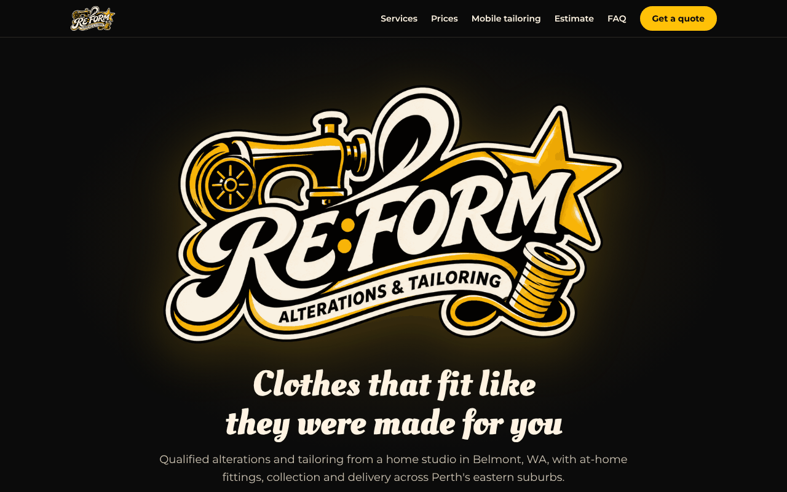
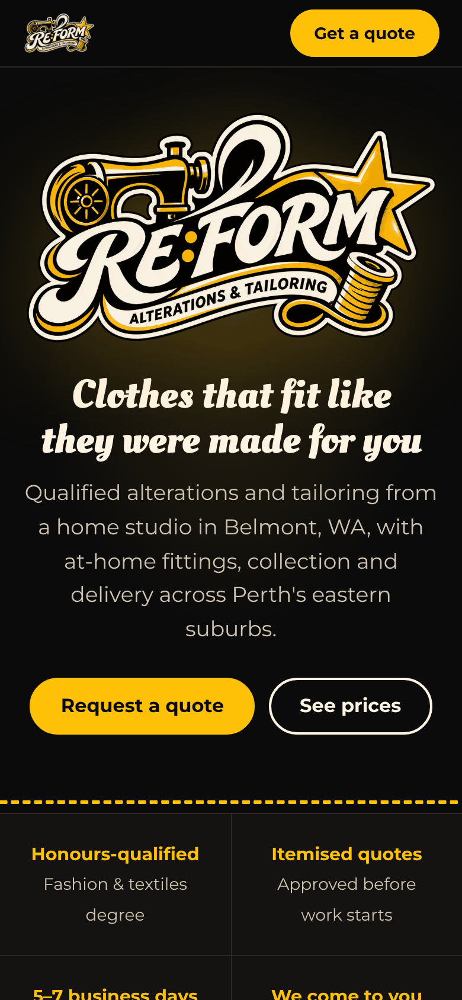
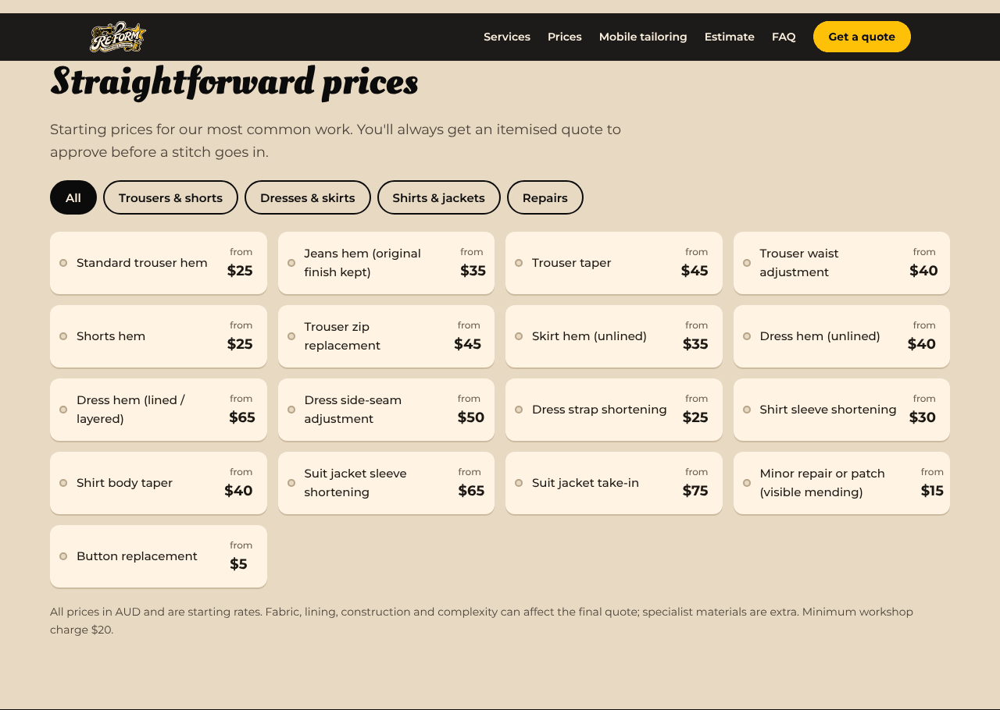
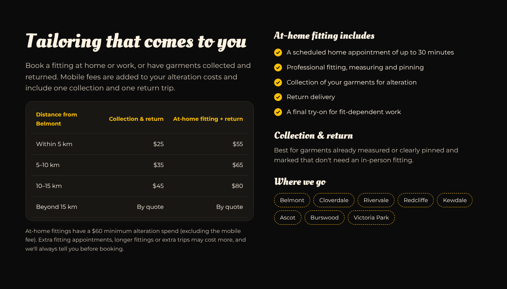
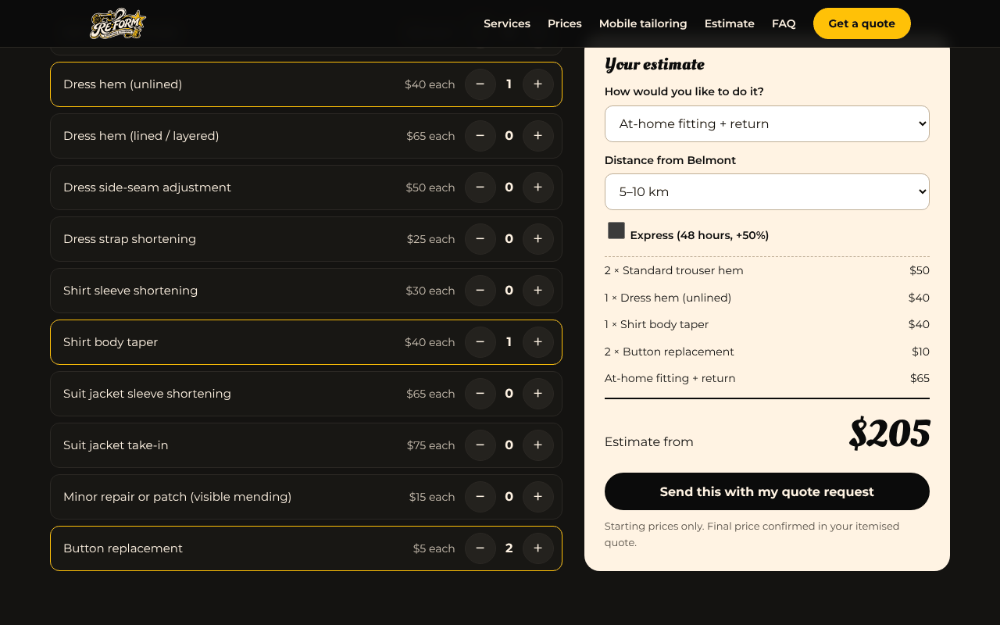
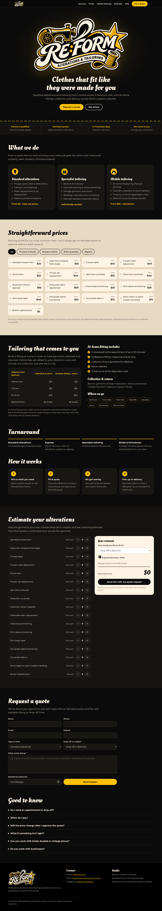
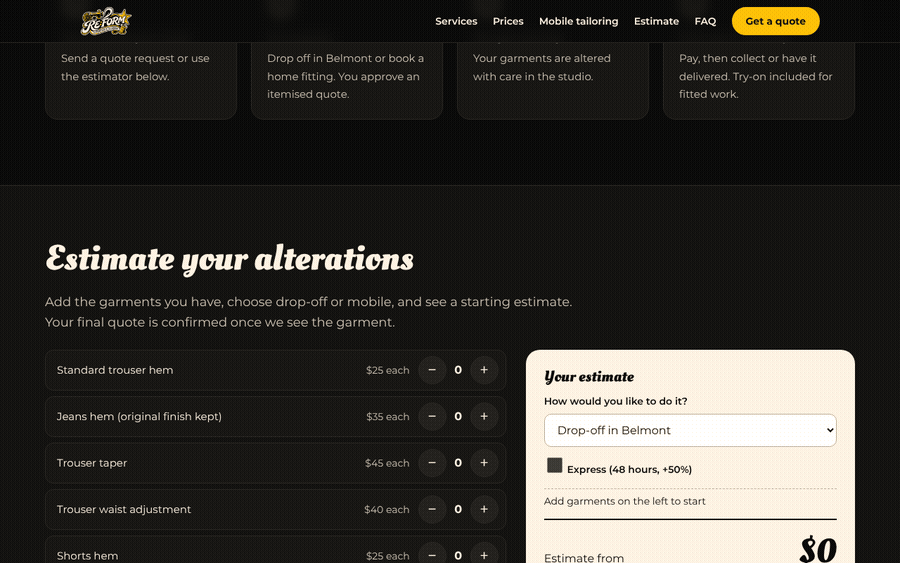
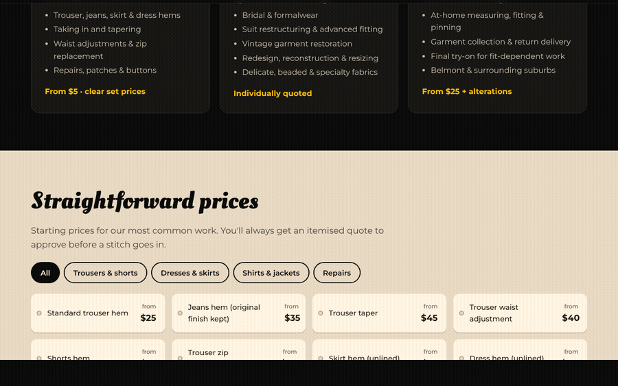

<!-- Animated header -->
<p align="center">
  
</p>

<p align="center">
  <a href="https://reform-alterations.vercel.app">
    
  </a>
</p>

<p align="center">
  
</p>

<p align="center">
  <a href="https://reform-alterations.vercel.app"></a>
  <a href="https://vercel.com/new/clone?repository-url=https://github.com/thedalycreative/reform-alterations"></a>
</p>

<p align="center">
  
  
  
  
  
  
  
  
  
</p>

<p align="center">
  <a href="#-features">Features</a> ·
  <a href="#-screenshots">Screenshots</a> ·
  <a href="#-demos">Demos</a> ·
  <a href="#-quick-start">Quick start</a> ·
  <a href="#-deployment">Deployment</a> ·
  <a href="#-editing-content">Editing content</a> ·
  <a href="#-pre-launch-checklist">Pre-launch checklist</a>
</p>

---

## ✂️ About

**RE:FORM** is a home-based alterations and tailoring studio in **Belmont, Western Australia**. It offers everyday alterations, specialist tailoring and a mobile service with at-home fittings, collection and delivery. The work is backed by an honours qualification in fashion and textiles.

This repository holds the business's one-page marketing website. It's plain HTML, CSS and JavaScript in a single `index.html`, with no framework, no build step and no dependencies. Push to `main` and Vercel deploys it.

## ✨ Features

| | Feature | What it does |
|---|---|---|
| 🎯 | **Brand-matched design** | Charcoal, cream, tawny and sand palette from the brand handoff, with Oleo Script headings and Montserrat body text |
| 🏷️ | **Filterable price list** | All 17 standard services shown as "from" prices on price-tag cards, filtered by trousers, dresses, shirts and jackets, or repairs |
| 🧮 | **Live price estimator** | Customers add garments, pick drop-off, collection or at-home fitting, choose a distance band and toggle express. Applies the $20 minimum charge, the +50% express loading and the $60 home-fitting minimum |
| 🚗 | **Mobile service pricing** | Distance-band table (within 5 km, 5–10 km, 10–15 km, beyond 15 km) with what each option includes |
| 📝 | **Quote request form** | Validates name and phone, pulls in the estimate, then sends to a form service or falls back to opening an email |
| ❓ | **FAQ** | Payment, deposits, quote changes in both directions, rework and specialist garments, using native `<details>` |
| 📱 | **Responsive** | Tested at 390 px (phone) and 1280 px (desktop); tables and grids stack cleanly |
| ♿ | **Accessible basics** | Semantic landmarks, alt text, 44 px tap targets, visible focus rings, `aria-live` estimate, reduced-motion support |
| ⚡ | **Lightweight** | About 31 KB of HTML plus a compressed logo (85 KB) and favicon; the only external requests are Google Fonts |

## 📸 Screenshots

<table>
  <tr>
    <td width="68%"></td>
    <td width="32%"></td>
  </tr>
  <tr>
    <td align="center"><sub>Desktop · 1280 px</sub></td>
    <td align="center"><sub>Phone · 390 px</sub></td>
  </tr>
</table>

<details>
<summary><b>More screenshots</b> (price list, mobile service, estimator, full page)</summary>
<br>

**Price list**


**Mobile tailoring**


**Estimator**


**Full page**


</details>

## 🎬 Demos

<table>
  <tr>
    <td align="center"><b>Price estimator</b></td>
    <td align="center"><b>Price list filter</b></td>
  </tr>
  <tr>
    <td></td>
    <td></td>
  </tr>
</table>

## 🧰 Tech stack

```text
HTML5 ─ semantic single page
CSS3  ─ custom properties, grid, clamp(), no framework
JS    ─ ~100 lines of vanilla ES2020, no libraries
Fonts ─ Google Fonts: Oleo Script 700, Montserrat 400–800
Host  ─ Vercel (static), auto-deploys from GitHub
```

## 🚀 Quick start

There's nothing to install or build. Clone it and open it:

```bash
git clone https://github.com/thedalycreative/reform-alterations.git
cd reform-alterations
```

Then preview it with any static server:

```bash
# Option 1: Node
npx serve .

# Option 2: Python
python3 -m http.server 8080

# Option 3: Vercel CLI (mirrors production, including vercel.json headers)
npx vercel dev
```

Open <http://localhost:3000> (serve / Vercel) or <http://localhost:8080> (Python).

> Opening `index.html` straight from your file browser also works. A local server is only needed to test `vercel.json` headers.

## 🏗️ Build

There is **no build step**. Vercel serves the repository root as static files.

| Vercel setting | Value |
|---|---|
| Framework preset | Other |
| Build command | *(none)* |
| Output directory | `.` (repository root) |
| Install command | *(none)* |

`vercel.json` turns on clean URLs and sets long-lived cache headers for images:

```json
{
  "cleanUrls": true,
  "trailingSlash": false,
  "headers": [
    { "source": "/(.*)\\.(png|gif|ico)", "headers": [{ "key": "Cache-Control", "value": "public, max-age=31536000, immutable" }] }
  ]
}
```

## ☁️ Deployment

This repo is linked to the Vercel project **reform-alterations**:

- **Production:** every push to `main` deploys to <https://reform-alterations.vercel.app>
- **Previews:** every other branch or pull request gets its own preview URL

To deploy your own copy, click the **Deploy with Vercel** badge above, or run:

```bash
npx vercel        # preview
npx vercel --prod # production
```

**Custom domain:** in Vercel go to *Project → Settings → Domains*, add your domain (for example `reformalterations.com.au`) and follow the DNS instructions.

## 📁 Project structure

```text
reform-alterations/
├── index.html               # The whole site: markup, styles and script
├── reform-logo.png          # Hero logo (transparent, 1000 px)
├── reform-logo-small.png    # Nav and footer logo (500 px)
├── favicon.png              # Browser tab icon (star from the logo)
├── vercel.json              # Static hosting config
├── docs/
│   └── media/               # README screenshots and GIFs (not used by the site)
└── README.md
```

## ✏️ Editing content

Everything lives in `index.html`.

### Prices

The price cards **and** the estimator both read from one array near the bottom of the file, so you edit each price once:

```js
const PRICES = [
  ['trousers', 'Standard trouser hem', 25],
  // [category, label, starting price in AUD]
];
```

Categories are `trousers`, `dresses`, `tops` and `repairs`. Mobile fees live in `MOBILE` just below it (`null` means "by quote").

### Quote form

By default the form opens the customer's email app with their request filled in. To receive submissions directly, create a free form at a service like [Formspree](https://formspree.io), then paste its endpoint into:

```js
const FORM_ENDPOINT = 'https://formspree.io/f/your-id';
```

### Colours and fonts

Brand colours are CSS variables at the top of the `<style>` block:

| Token | Hex | Use |
|---|---|---|
| `--bg` | `#0B0B0B` | Charcoal background |
| `--ink` | `#FFF3E3` | Cream text |
| `--gold` | `#FFC107` | Tawny accent and buttons |
| `--sand` | `#E8D9C3` | Price list band |

## ✅ Pre-launch checklist

- [ ] Replace placeholder phone `0400 000 000` (footer)
- [ ] Replace placeholder email `hello@reformalterations.com.au` (footer and `EMAIL` in the script)
- [ ] Replace placeholder Instagram `@reform.alterations` (footer)
- [ ] Confirm studio hours (footer)
- [ ] Connect the quote form with `FORM_ENDPOINT`
- [ ] Confirm GST treatment and add a note to the price list
- [ ] Recheck competitor pricing before finalising public rates
- [ ] Add a custom domain in Vercel

## 🗺️ Roadmap ideas

- Online booking link (Square Appointments or Calendly)
- Before-and-after gallery of real work
- Google Business Profile reviews (real ones only)
- `LocalBusiness` structured data for local SEO

## 📄 Licence

© 2026 RE:FORM Alterations & Tailoring. All rights reserved. The RE:FORM name, logo and brand assets may not be reused without permission.

<p align="center">
  
</p>
